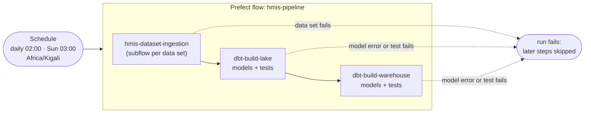

# HMIS data platform: DHIS2 → Silo → ClickHouse → Metabase

An end-to-end teaching pipeline for routine health information (HMIS) data.
It pulls aggregate data from the public DHIS2 demo (Sierra Leone database),
lands it in a **Silo data lake**, models it with **dbt** through the
medallion layers, serves analysis-ready **gold marts from ClickHouse**, and
shows them on a **Metabase** dashboard. **Prefect** orchestrates the whole
chain on a schedule.

- **Data lake (Silo):** keeps every layer up to *intermediate* as files,
  cheap and readable by any engine.
- **Warehouse (ClickHouse):** holds only the *gold* marts that people and
  dashboards query.

## Architecture

```mermaid
flowchart LR
    DHIS2[("DHIS2 Web API<br/>play demo")]

    subgraph LAKE["Silo: data lake · s3://hmis-datalake"]
        direction TB
        RAW["raw/<br/>API payloads as received<br/>(gzipped JSON)"]
        LAND["landing/<br/>typed, de-duplicated Parquet<br/>per data set and period"]
        STG["staging/<br/>stg_dhis2__*<br/>cleaned, one model per source"]
        INT["intermediate/<br/>int_dhis2__*<br/>joined, hierarchy, ISO weeks"]
        RAW --> LAND --> STG --> INT
    end

    subgraph WH["ClickHouse: warehouse"]
        direction TB
        LV["lake.* views<br/>read Parquet in place<br/>via s3(silo, …)"]
        GOLD["gold.*<br/>dim_org_unit<br/>fct_monthly / weekly / reporting"]
        LV --> GOLD
    end

    MB["Metabase<br/>HMIS Overview dashboard"]

    DHIS2 -->|"Prefect: extract"| RAW
    INT -->|"read in place, no copy"| LV
    GOLD -->|"read-only user"| MB
```



| Step | Tool | From → To | What happens |
|---|---|---|---|
| 1. Ingest | Prefect + Python (`dataset_ingestion.py`) | DHIS2 → `raw/`, `landing/` | Extract data values and metadata, keep payloads as received, normalise to typed Parquet partitioned by period, track watermarks |
| 2. Lake models | dbt + DuckDB (`dbt/lake`) | `landing/` → `staging/` → `intermediate/` | Rename, cast and trim; parse DHIS2 periods into dates; join names and the org unit hierarchy; put weekly data on ISO weeks. Written back to Silo as Parquet |
| 3. Warehouse models | dbt + ClickHouse (`dbt/warehouse`) | `intermediate/` → `gold` | ClickHouse reads the intermediate Parquet straight from Silo and builds aggregated MergeTree marts |
| 4. Dashboards | Metabase (`metabase/`) | `gold` → charts | Read-only access to `gold` only |

Prefect runs steps 1 to 3 as one flow. The dashboard queries ClickHouse live,
so it shows new data as soon as gold is rebuilt.

### Orchestration



Steps run in order and the run **stops at the first failure**, so gold is
never rebuilt from bad data. dbt *warnings* (known data-quality issues with
`severity: warn`) are logged but do not stop the run.

### Medallion layers

| Layer | Lives in | Format | Built by | Grain / contents |
|---|---|---|---|---|
| raw | Silo `raw/dhis2/` | JSON.gz | Prefect | One object per API request, untouched, for replay and audit |
| landing | Silo `landing/dhis2/` | Parquet | Prefect | Data values per data set and period; metadata snapshots |
| staging | Silo `staging/dhis2/` | Parquet | dbt/lake | One model per source: snake_case IDs, types, trimmed names, period start/end dates |
| intermediate | Silo `intermediate/dhis2/` | Parquet | dbt/lake | One row per facility × period × data element × disaggregation, with names and country → district → chiefdom → facility; weekly values on ISO weeks |
| gold | ClickHouse `gold` | MergeTree tables | dbt/warehouse | District-level marts for dashboards |

**Why gold is only in ClickHouse:** Silo keeps the detailed, reusable data
(intermediate). Gold is a set of aggregates built from it in seconds, so a
second copy in the lake would only need keeping in sync. If ClickHouse is
lost, `dbt build` in `dbt/warehouse` recreates gold from Silo.

### Gold marts

| Table | Grain | Use |
|---|---|---|
| `gold.dim_org_unit` | org unit | Country → district → chiefdom → facility |
| `gold.fct_monthly_indicators_district` | data set × month × district × data element × disaggregation | Monthly indicators (Child Health, Reproductive Health) |
| `gold.fct_weekly_idsr_district` | ISO week × district × disease | Weekly notifiable disease surveillance (IDSR) |
| `gold.fct_reporting_monthly_district` | data set × month × district | Facilities reporting and a proxy reporting rate |

## Services

All services run in Docker inside WSL Ubuntu (`docker compose up -d`,
project `hmis-silo`) and restart by themselves when Ubuntu starts. Host
ports are shifted from the defaults so the stack can run next to another
MinIO/ClickHouse on the same machine.

| Service | URL / port | Local login (teaching defaults, see `.env`) | Purpose |
|---|---|---|---|
| Silo | console http://localhost:9101 · S3 API `:9100` | `minioadmin` / `minioadmin` | Data lake |
| ClickHouse | http://localhost:8124/play · native `:9010` | `hmis` / `hmis` (read-write) | Warehouse |
| Prefect server | http://localhost:4200 | none | Orchestration UI, API, schedules |
| Metabase | http://localhost:3010 | `admin@hmis.local` / `HmisAdmin2026!` | Dashboards |

On the host (WSL), not in Docker:

| Component | Where | Purpose |
|---|---|---|
| Prefect worker | `./start_worker.sh`, venv `~/venvs/hmis-ingestion` | Executes flow runs (ingestion code + calls dbt) |
| dbt | venv `~/venvs/hmis-dbt` (`DBT_EXECUTABLE`) | dbt-duckdb and dbt-clickhouse, kept apart from Prefect's dependencies |

Metabase connects to ClickHouse as a separate **read-only** user,
`metabase`, that can only read `gold`. Change all of these credentials
before using the stack anywhere but a laptop.

## Repository layout

```
.
├── hmis.py                  base layer: config loader, DHIS2Client, DataLake, transforms, run_dbt
├── dataset_ingestion.py     Prefect flows: hmis_pipeline (deployed) and hmis_ingestion
├── ingestion_config.yml     source, lake, ingestion, transform (dbt) and data set settings
├── prefect.yaml             deployments: daily incremental, weekly full refresh, backfill
├── start_worker.sh          starts the Prefect worker (WSL)
├── docker-compose.yml       Silo, ClickHouse, Prefect server, Metabase
├── requirements.txt         pipeline dependencies (Prefect, minio, pandas, pyarrow …)
├── .env.example             settings and local credentials (copy to .env)
├── clickhouse/
│   ├── config.d/silo.xml    named collection `silo`: lake URL + keys, kept out of SQL
│   └── users.d/             grant for `hmis`; read-only `metabase` user
├── dbt/
│   ├── lake/                dbt-duckdb: landing → staging → intermediate (Parquet in Silo)
│   └── warehouse/           dbt-clickhouse: intermediate → gold marts
└── metabase/
    └── setup_metabase.py    dashboard as code: connection, questions, HMIS Overview
```

Each of `dbt/lake`, `dbt/warehouse` and `metabase` has its own README with
details.

## Quick start (WSL)

Everything runs in WSL Ubuntu (Docker lives there).

```bash
cd "<repo>"
cp .env.example .env                       # then set DBT_EXECUTABLE (below)

# 1. Two virtualenvs, so Prefect and dbt dependencies never clash
python3 -m venv ~/venvs/hmis-ingestion
~/venvs/hmis-ingestion/bin/pip install -r requirements.txt
python3 -m venv ~/venvs/hmis-dbt
~/venvs/hmis-dbt/bin/pip install "dbt-core>=1.10" "dbt-duckdb>=1.9" "dbt-clickhouse>=1.9"
# .env: DBT_EXECUTABLE=/home/<you>/venvs/hmis-dbt/bin/dbt

# 2. Services
docker compose up -d

# 3. Run the whole pipeline once (ingest -> dbt lake -> dbt warehouse)
source ~/venvs/hmis-ingestion/bin/activate
python dataset_ingestion.py --mode full --lookback-months 12

# 4. Dashboard (once; safe to re-run)
python metabase/setup_metabase.py          # -> http://localhost:3010
```

Other local runs:

```bash
python dataset_ingestion.py                # incremental (config default), then dbt
python dataset_ingestion.py --skip-dbt     # ingest only
python dataset_ingestion.py --mode full --lookback-months 3 --datasets child_health
```

## Orchestration (Prefect)

| Deployment | Schedule (Africa/Kigali) | What it does |
|---|---|---|
| `hmis-daily-incremental` | daily 02:00 | values changed since the last run, then both dbt builds |
| `hmis-weekly-full-refresh` | Sunday 03:00 | reload the last 12 months (catches deletions), then dbt |
| `hmis-backfill` | manual | full reload (default 24 months), then dbt |

One-time setup:

```bash
source ~/venvs/hmis-ingestion/bin/activate
prefect profile create hmis
prefect --profile hmis config set PREFECT_API_URL=http://localhost:4200/api
prefect profile use hmis
prefect work-pool create hmis-process-pool --type process
prefect deploy --all
```

Run the worker. It executes every run, so keep its terminal open:

```bash
./start_worker.sh
```

Start a run by hand: http://localhost:4200 → Deployments → Run, or
`prefect deployment run "hmis-pipeline/hmis-daily-incremental"`.
Add `-p with_dbt=false` to ingest without rebuilding the models.

**On a laptop:** WSL stops Ubuntu when no terminal is open, which stops
Docker and the worker. Scheduled runs only happen while Ubuntu is running;
missed ones show as *Late* in the Prefect UI. The containers come back by
themselves when Ubuntu starts; the worker needs `./start_worker.sh` again.

## How ingestion loads

- **full:** requests one calendar month at a time over `lookback_months`
  and overwrites each period partition it touches. Each window starts
  `overlap_days` early, because DHIS2 only returns periods that fall
  entirely inside the requested dates. Without the overlap, weeks crossing a
  month boundary would be lost; the duplicates this creates are removed.
- **incremental:** one `lastUpdated=<watermark>` request per data set, with
  the changed values upserted into existing partitions. The watermark is the
  DHIS2 server time taken at the *start* of the run. The first incremental
  run of a data set falls back to a full load.
- A failing data set doesn't stop the others in ingestion, but the run is
  marked failed (so dbt does not run) and the manifest records the error.

Lake layout (bucket `hmis-datalake`):

```
raw/dhis2/metadata/<entity>/run_id=<ts>/<entity>.json.gz
raw/dhis2/data_values/dataset=<key>/run_id=<ts>/<YYYY-MM|incremental>.json.gz
landing/dhis2/metadata/<entity>/<entity>.parquet                  # latest snapshot
landing/dhis2/data_values/dataset=<key>/period=<period>/data.parquet
staging/dhis2/stg_dhis2__<source>.parquet                         # dbt/lake
intermediate/dhis2/int_dhis2__<model>.parquet                     # dbt/lake
_state/dhis2/data_values/<key>.json                               # incremental watermark
_runs/dhis2/<run_id>.json                                         # run manifest
```

## Data quality

dbt tests run as part of every `dbt build`. A failing test stops the
pipeline; a warning is logged.

| Where | Check | Severity |
|---|---|---|
| lake | unique / not-null keys; every data value's data element, org unit, disaggregation and data set exists in metadata | error |
| lake | every period parses; weekly periods start on their weekday; ISO weeks run Monday–Sunday | error |
| lake | each ISO week built from a single report type (no double counting) | error |
| lake | value updated before it was created (demo data quirk, 126k rows) | warn |
| lake | period type differs from its data set's (IDSR Wednesday weeks, a few daily values) | warn |
| warehouse | unique keys; every district in the facts exists in `dim_org_unit` | error |
| warehouse | gold totals equal lake totals per data set (aggregation lost or invented nothing) | error |

Known quirks of the demo database, and how they are handled:

- **IDSR Weekly** is an ISO-weekly form, but the demo also stores weeks as
  Wednesday weeks, and five weeks in both forms. `int_dhis2__weekly_values_iso`
  moves a Wednesday week to the ISO week holding 5 of its 7 days, and only
  where that ISO week has no ISO report, so no week is counted twice.
- **Reproductive Health** (monthly) holds 3 daily values; the monthly marts
  leave them out.
- **Reporting rate** is a proxy: facilities reporting ÷ all facilities in
  the district, because data set assignments are not ingested yet.

## Adding a data set

Find its UID (`/api/dataSets.json?fields=id,name,periodType&paging=false`)
and add an entry under `datasets:` in `ingestion_config.yml`. For quarterly,
six-monthly or yearly data sets, set `chunk_months: 3`, `6` or `12` so each
request window holds whole periods. The lake models pick it up
automatically; add or extend a gold mart in `dbt/warehouse` to report on it.

## Troubleshooting

- **A web page (Silo, ClickHouse, Prefect, Metabase) does not load:**
  Ubuntu has probably shut down. Open an Ubuntu terminal; the containers
  start within seconds (`docker compose ps` to check).
- **No scheduled runs happen:** the worker is not running. Start
  `./start_worker.sh`; the Prefect UI (Work Pools → hmis-process-pool) shows
  it as *Online*.
- **Port already in use:** another stack (e.g. a second MinIO or ClickHouse)
  owns the default ports; this stack uses 9100/9101, 8124/9010, 4200 and
  3010 for that reason.
- **DHIS2 returns 404:** the play server rotates versions. Pick a current
  instance on https://play.dhis2.org and set `DHIS2_BASE_URL` in `.env`.

## Notes

- MinIO's community edition was archived in 2026. **Silo**
  (https://github.com/pgsty/silo) is its maintained fork: same S3 API,
  ports inside the container, `MINIO_ROOT_*` variables and on-disk format.
  The `MINIO_*` settings here work with Silo, MinIO or any S3-compatible
  service.
- dbt runs on dbt Core 1.x (`dbt-duckdb`, `dbt-clickhouse`).
