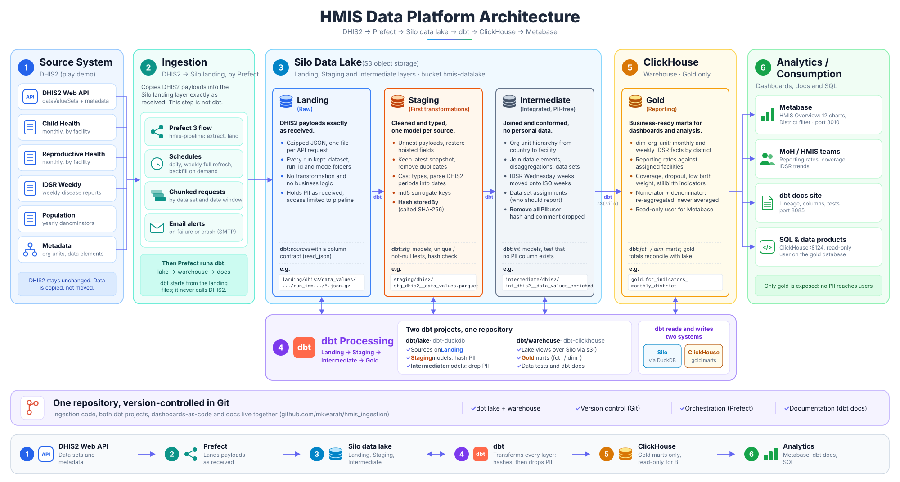
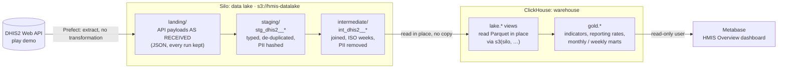
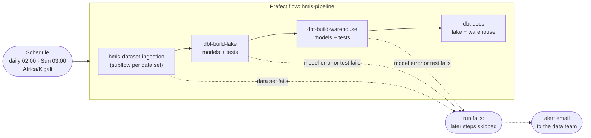

# HMIS data platform: DHIS2 → Silo → ClickHouse → Metabase

An end-to-end teaching pipeline for routine health information (HMIS) data.
It pulls aggregate data from the public DHIS2 demo (Sierra Leone database),
lands it **exactly as received** in a **Silo data lake**, transforms it with
**dbt** through the medallion layers (hashing personal data in staging and
removing it in intermediate), serves analysis-ready **gold marts from
ClickHouse**, and shows them on a **Metabase** dashboard. **Prefect**
orchestrates the whole chain on a schedule and emails the team when a run
fails.

- **Data lake (Silo):** keeps every layer up to *intermediate* as files:
  the raw truth, cheap, and readable by any engine.
- **Warehouse (ClickHouse):** holds only the *gold* marts that people and
  dashboards query. It never sees personal data.

## Architecture



Prefect copies DHIS2 into **landing** exactly as received. Everything after
that is **dbt**: the `dbt/lake` project (dbt-duckdb) builds **staging**
(hash PII) and **intermediate** (drop PII) back into Silo, and the
`dbt/warehouse` project (dbt-clickhouse) builds the **gold** marts in
ClickHouse. The poster is plain SVG (`docs/architecture.svg`), so it can be
opened in a browser or edited in any vector tool. The diagrams below show
the same flow in more detail.



| Step | Tool | From → To | What happens |
|---|---|---|---|
| 1. Ingest | Prefect + Python (`dataset_ingestion.py`) | DHIS2 → `landing/` | Extract data values and metadata and store the API responses **untouched**, one JSON object per request, every run kept. Track watermarks. No transformation. |
| 2. Staging | dbt + DuckDB (`dbt/lake`) | `landing/` → `staging/` | **First transformations:** parse the JSON against an explicit column contract, restore fields DHIS2 hoists to the payload level, keep the current snapshot, remove duplicates, cast types, parse DHIS2 periods into dates, build surrogate keys and **hash personal data** |
| 3. Intermediate | dbt + DuckDB (`dbt/lake`) | `staging/` → `intermediate/` | Joins (names, country → district → chiefdom → facility), weekly data on ISO weeks, data set assignments, and **removal of all personal data** |
| 4. Gold | dbt + ClickHouse (`dbt/warehouse`) | `intermediate/` → `gold` | ClickHouse reads the intermediate Parquet straight from Silo and builds aggregated marts and derived indicators |
| 5. Dashboards | Metabase (`metabase/`) | `gold` → charts | Read-only access to `gold` only |

Prefect runs steps 1 to 4 as one flow, then regenerates the dbt docs site.
The dashboard queries ClickHouse live, so it shows new data as soon as gold
is rebuilt.

### Orchestration and alerts



Steps run in order and the run **stops at the first failure**, so gold is
never rebuilt from bad data. A failed or crashed run sends an **email** with
the reason and a link to the run. dbt *warnings* (known data-quality issues,
`severity: warn`) are logged but do not stop the run. The docs step never
fails a run.

### Medallion layers

| Layer | Lives in | Format | Built by | Contents | Personal data |
|---|---|---|---|---|---|
| landing | Silo `landing/dhis2/` | gzipped JSON | Prefect | DHIS2 API payloads as received; one object per request; every run kept (replayable) | yes, as received |
| staging | Silo `staging/dhis2/` | Parquet | dbt/lake | One model per source: current snapshot, typed, de-duplicated, periods as dates, surrogate keys | **hashed** (`stored_by_hash`); comment text kept |
| intermediate | Silo `intermediate/dhis2/` | Parquet | dbt/lake | One row per facility × period × data element × disaggregation with names and hierarchy; ISO weeks; data set assignments | **none** (enforced by a test) |
| gold | ClickHouse `gold` | MergeTree tables | dbt/warehouse | District-level marts and indicators for dashboards | none |

**Why gold is only in ClickHouse:** Silo keeps the detailed, reusable data
(intermediate). Gold is a set of aggregates built from it in seconds, so a
second copy in the lake would only need keeping in sync. If ClickHouse is
lost, `dbt build` in `dbt/warehouse` recreates gold from Silo.

### Personal data (PII)

Aggregate DHIS2 data has no patient records, but each value carries two
personal fields: **`storedBy`** (the user name of the person who entered it)
and **`comment`** (free text that may name people).

| Layer | `storedBy` | `comment` |
|---|---|---|
| landing | as received | as received |
| staging | **`stored_by_hash`**: salted SHA-256, groupable per user, not reversible | kept |
| intermediate and gold | **removed** | **removed**; only `has_comment` (true/false) |

- **The salt** (`HMIS_HASH_SALT` in `.env`) is a secret key. A dbt-duckdb
  plugin (`dbt/lake/plugins/hmis_pii.py`) hands it to DuckDB as a session
  variable, so it never appears in SQL, logs or the docs site. If it is
  missing, the build fails instead of producing empty hashes.
- **Tests enforce it.** `assert_stored_by_is_hashed` checks that every landed
  user name has a well-formed hash in staging, and `assert_no_pii_in_intermediate`
  fails the build if any intermediate model has a personal-data column.
- **Access:** landing and staging still hold personal data, so access to the
  Silo bucket must be restricted. The warehouse and dashboards never get it.

### Gold marts

| Table | Grain | Use |
|---|---|---|
| `gold.dim_org_unit` | org unit | Country → district → chiefdom → facility |
| `gold.fct_monthly_indicators_district` | data set × month × district × data element × disaggregation | Monthly counts (Child Health, Reproductive Health) |
| `gold.fct_weekly_idsr_district` | ISO week × district × disease | Weekly notifiable disease surveillance (IDSR) |
| `gold.fct_reporting_monthly_district` | data set × month × district | Reporting rate: assigned facilities that reported ÷ facilities assigned the form |
| `gold.fct_indicators_monthly_district` | indicator × month × district | Coverage (BCG, Penta3, Measles, ANC1), dropout (Penta1→3, ANC1→4), low birth weight %, stillbirth rate, each with **numerator and denominator** |

Rates are always re-aggregated from their parts:
`sum(numerator) / sum(denominator) × multiplier`, never averaged. Coverage
denominators come from the yearly **Population** data set (target ÷ 12 per
month).

## Services

All services run in Docker inside WSL Ubuntu (`docker compose up -d`,
project `hmis-silo`) and restart by themselves when Ubuntu starts. Host
ports are shifted from the defaults so the stack can run next to another
MinIO/ClickHouse on the same machine.

| Service | URL / port | Local login (teaching defaults, see `.env`) | Purpose |
|---|---|---|---|
| Silo | console http://localhost:9101 · S3 API `:9100` | `minioadmin` / `minioadmin` | Data lake |
| ClickHouse | http://localhost:8124/play · native `:9010` | `hmis` / `hmis` (read-write) | Warehouse |
| Prefect server | http://localhost:4200 | none | Orchestration UI, API, schedules |
| Metabase | http://localhost:3010 | `admin@hmis.local` / `HmisAdmin2026!` | Dashboards |
| dbt docs | http://localhost:8085 | none | Models, columns, tests and lineage of both dbt projects |
| Mailpit | http://localhost:8025 · SMTP `:1025` | none | Test inbox that catches alert emails |

On the host (WSL), not in Docker:

| Component | Where | Purpose |
|---|---|---|
| Prefect worker | `./start_worker.sh`, venv `~/venvs/hmis-ingestion` | Executes flow runs (ingestion code + calls dbt) |
| dbt | venv `~/venvs/hmis-dbt` (`DBT_EXECUTABLE`) | dbt-duckdb and dbt-clickhouse, kept apart from Prefect's dependencies |

Metabase connects to ClickHouse as a separate **read-only** user,
`metabase`, that can only read `gold`. Change all of these credentials
before using the stack anywhere but a laptop.

## Repository layout

```
.
├── hmis.py                  base layer: config loader, DHIS2Client, DataLake, run_dbt, send_email
├── dataset_ingestion.py     Prefect flows: hmis_pipeline (deployed) and hmis_ingestion; alert hook
├── ingestion_config.yml     source, lake, ingestion, transform (dbt), alerts and data set settings
├── prefect.yaml             deployments: daily incremental, weekly full refresh, backfill
├── setup.sh                 one-command install on a laptop (see Quick start)
├── start_worker.sh          starts the Prefect worker (WSL)
├── docker-compose.yml       Silo, ClickHouse, Prefect, Metabase, dbt docs, Mailpit
├── requirements.txt         pipeline dependencies (Prefect, minio, PyYAML, requests, dotenv)
├── requirements-dbt.txt     dbt-core, dbt-duckdb, dbt-clickhouse (pinned, own venv)
├── .env.example             settings, secrets and local credentials (copy to .env)
├── clickhouse/
│   ├── config.d/silo.xml    named collection `silo`: lake URL + keys, kept out of SQL
│   └── users.d/             grant for `hmis`; read-only `metabase` user
├── dbt/
│   ├── lake/                dbt-duckdb: landing → staging → intermediate (Parquet in Silo)
│   │   └── plugins/         hmis_pii.py: hands the hashing salt to DuckDB
│   └── warehouse/           dbt-clickhouse: intermediate → gold marts and indicators
├── metabase/
│   └── setup_metabase.py    dashboard as code: connection, questions, HMIS Overview
└── docs/
    ├── index.html           landing page of the dbt docs site
    └── architecture.svg     architecture poster shown at the top of this README
```

`dbt/lake`, `dbt/warehouse` and `metabase` each have their own README.

## Quick start (WSL)

Everything runs in WSL Ubuntu (Docker lives there).

### One command

**What you need first:**

- **On Windows:** WSL with Ubuntu (`wsl --install -d Ubuntu` in PowerShell),
  then Docker inside it (Docker Engine, or Docker Desktop with WSL
  integration turned on).
- **In Ubuntu:** `sudo apt install git curl python3 python3-venv`.

Then, in an Ubuntu terminal:

```bash
git clone https://github.com/mkwarah/hmis_ingestion.git ~/hmis_ingestion
cd ~/hmis_ingestion
./setup.sh                 # add --skip-data to install without loading data
./start_worker.sh          # keep this terminal open for scheduled runs
```

`setup.sh` checks the prerequisites and creates `.env` with a new hashing
salt. It then installs both virtualenvs, starts the containers, registers
the Prefect deployments, loads 12 months from the DHIS2 demo through every
layer, and builds the Metabase dashboard. It finishes by printing every URL.
It is safe to run again: steps already done are skipped and existing `.env`
values are kept. Clone into the Ubuntu home folder (as above), not
`/mnt/c/...`, so file access stays fast.

### Step by step

The same steps by hand, if you want to see each one:

```bash
cd "<repo>"
cp .env.example .env
# In .env set:
#   DBT_EXECUTABLE=/home/<you>/venvs/hmis-dbt/bin/dbt
#   HMIS_HASH_SALT=<output of: python3 -c "import secrets;print(secrets.token_hex(32))">

# 1. Two virtualenvs, so Prefect and dbt dependencies never clash
python3 -m venv ~/venvs/hmis-ingestion
~/venvs/hmis-ingestion/bin/pip install -r requirements.txt
python3 -m venv ~/venvs/hmis-dbt
~/venvs/hmis-dbt/bin/pip install -r requirements-dbt.txt

# 2. Services
docker compose up -d

# 3. Run the whole pipeline once (ingest -> dbt lake -> dbt warehouse -> docs)
source ~/venvs/hmis-ingestion/bin/activate
python dataset_ingestion.py --mode full --lookback-months 12

# 4. Dashboard (once; safe to re-run)
python metabase/setup_metabase.py          # -> http://localhost:3010
```

Other local runs:

```bash
python dataset_ingestion.py                # incremental (config default), then dbt
python dataset_ingestion.py --skip-dbt     # ingest only
python dataset_ingestion.py --mode full --lookback-months 3 --datasets child_health
```

To run dbt by hand, export `.env` first (dbt needs `HMIS_HASH_SALT` and
the `MINIO_*` settings): `set -a; . ./.env; set +a`, then `cd dbt/lake && dbt build`.

## Orchestration (Prefect)

| Deployment | Schedule (Africa/Kigali) | What it does |
|---|---|---|
| `hmis-daily-incremental` | daily 02:00 | values changed since the last run, then dbt and docs |
| `hmis-weekly-full-refresh` | Sunday 03:00 | reload the last 12 months (a fresh snapshot), then dbt and docs |
| `hmis-backfill` | manual | full reload (default 24 months), then dbt and docs |

One-time setup:

```bash
source ~/venvs/hmis-ingestion/bin/activate
prefect profile create hmis
prefect --profile hmis config set PREFECT_API_URL=http://localhost:4200/api
prefect profile use hmis
prefect work-pool create hmis-process-pool --type process
prefect deploy --all
```

Run the worker. It executes every run, so keep its terminal open:

```bash
./start_worker.sh
```

Start a run by hand: http://localhost:4200 → Deployments → Run, or
`prefect deployment run "hmis-pipeline/hmis-daily-incremental"`.
Add `-p with_dbt=false` to ingest without rebuilding the models.

**On a laptop:** WSL stops Ubuntu when no terminal is open, which stops
Docker and the worker. Scheduled runs only happen while Ubuntu is running;
missed ones show as *Late* in the Prefect UI. The containers come back by
themselves when Ubuntu starts; the worker needs `./start_worker.sh` again.

### Alerts

When `hmis-pipeline` fails or crashes, the flow's `notify_failure` hook
emails the reason, the run parameters and a link to the run in the Prefect
UI. Settings are the `alerts` section of `ingestion_config.yml`, filled from
`.env`:

- **Default:** delivered to **Mailpit** (http://localhost:8025), a local
  test inbox, so alerts can be seen and tested without a mail account.
- **Real email:** set `SMTP_HOST`, `SMTP_PORT`, `SMTP_STARTTLS`,
  `SMTP_USERNAME`, `SMTP_PASSWORD`, `ALERT_EMAIL_FROM` and `ALERT_EMAIL_TO`
  (comma-separated). For Office 365: `smtp.office365.com`, port 587,
  STARTTLS true, and the sending account's address and password (or app
  password).
- `ALERTS_ENABLED=false` turns alerts off.

### dbt docs

After every successful build the pipeline runs `dbt docs generate --static`
for both projects. http://localhost:8085 links to both sites: model and
column descriptions, the tests on each model, compiled SQL and the lineage
graph from landing sources to gold marts.

## How ingestion loads

Ingestion never transforms data: it stores each API response as received
and leaves interpretation to dbt staging.

- **full:** requests one calendar month at a time over `lookback_months`
  (yearly data sets one year at a time) and lands each response. Each window
  starts `overlap_days` early, because DHIS2 only returns periods that fall
  entirely inside the requested dates. Without the overlap, weeks crossing a
  month boundary would be lost. Staging removes the resulting duplicates.
- **incremental:** one `lastUpdated=<watermark>` request per data set. The
  watermark is the DHIS2 server time taken at the *start* of the run. The
  first incremental run of a data set falls back to a full load.
- **Snapshot rule in staging:** a full run is a complete snapshot of the
  periods it covers. For each data set and period, staging keeps rows from
  the latest full run onward (later incremental changes win), so values
  deleted in DHIS2 disappear at the next weekly full refresh.
- A failing data set doesn't stop the others in ingestion, but the run is
  marked failed (so dbt does not run, and an alert is sent) and the
  manifest records the error.

Lake layout (bucket `hmis-datalake`):

```
landing/dhis2/metadata/<entity>/run_id=<ts>/<entity>.json.gz
landing/dhis2/data_values/dataset=<key>/data_set_id=<uid>/run_id=<ts>/mode=<full|incremental>/<YYYY-MM|incremental>.json.gz
staging/dhis2/stg_dhis2__<source>.parquet                         # dbt/lake
intermediate/dhis2/int_dhis2__<model>.parquet                     # dbt/lake
_state/dhis2/data_values/<key>.json                               # incremental watermark
_runs/dhis2/<run_id>.json                                         # run manifest
```

The folder names (`dataset=`, `run_id=`, `mode=`) become columns in dbt
through hive partitioning.

## Data quality

dbt tests run as part of every `dbt build`. A failing test stops the
pipeline (and sends an alert); a warning is logged.

| Where | Check | Severity |
|---|---|---|
| lake | unique / not-null keys; every data value's data element, org unit, disaggregation and data set exists in metadata; every assignment points to a real data set and org unit | error |
| lake | every period parses; weekly periods start on their weekday; ISO weeks run Monday–Sunday | error |
| lake | each ISO week built from a single report type (no double counting) | error |
| lake | every landed user name is hashed, and hashes are well-formed SHA-256 | error |
| lake | no intermediate model has a personal-data column | error |
| lake | value updated before it was created (demo data quirk, 126k rows) | warn |
| lake | period type differs from its data set's (IDSR Wednesday weeks, a few daily values) | warn |
| warehouse | unique keys; every district in the facts exists in `dim_org_unit`; known indicator codes | error |
| warehouse | gold totals equal lake totals per data set (aggregation lost or invented nothing) | error |
| warehouse | reporting rate never above 100% or above facilities expected | error |
| warehouse | indicator without a denominator (e.g. missing population figure) | warn |

Known quirks of the demo database, and how they are handled:

- **IDSR Weekly** is an ISO-weekly form, but the demo also has a separate
  "IDSR Weekly (Start Wednesday)" form sharing its data elements, so
  Wednesday weeks appear too, and five weeks exist in both forms.
  `int_dhis2__weekly_values_iso` moves a Wednesday week to the ISO week
  holding 5 of its 7 days, and only where that ISO week has no ISO report,
  so no week is counted twice.
- **Reproductive Health** (monthly) holds 3 daily values; the monthly marts
  leave them out.
- **Reporting rate** counts a facility as reporting when it sent any value
  for the form that month. DHIS2's own reporting rate uses completeness
  registrations, which are not ingested yet.
- **Coverage above 100%** (e.g. ANC1) and **negative dropout** in some
  district-months come from the demo data and are real data-quality signals,
  not calculation errors.

## Adding a data set

Find its UID (`/api/dataSets.json?fields=id,name,periodType&paging=false`)
and add an entry under `datasets:` in `ingestion_config.yml`. For quarterly,
six-monthly or yearly data sets, set `chunk_months: 3`, `6` or `12` so each
request window holds whole periods. Landing, staging and intermediate pick
it up automatically; add or extend a gold mart in `dbt/warehouse` (and a
question in `metabase/setup_metabase.py`) to report on it.

## Troubleshooting

- **A web page (Silo, ClickHouse, Prefect, Metabase, docs, Mailpit) does
  not load:** Ubuntu has probably shut down. Open an Ubuntu terminal; the
  containers start within seconds (`docker compose ps` to check).
- **No scheduled runs happen:** the worker is not running. Start
  `./start_worker.sh`; the Prefect UI (Work Pools → hmis-process-pool) shows
  it as *Online*.
- **dbt fails with "HMIS_HASH_SALT must be set":** add the salt to `.env`
  (see Quick start), and export `.env` when running dbt by hand.
- **Port already in use:** another stack (e.g. a second MinIO or ClickHouse)
  owns the default ports; this stack uses 9100/9101, 8124/9010, 4200, 3010,
  8085, 8025 and 1025 for that reason.
- **DHIS2 returns 404 or is very slow:** the play server rotates versions
  and is shared. Pick a current instance on https://play.dhis2.org and set
  `DHIS2_BASE_URL` in `.env`.

## Notes

- MinIO's community edition was archived in 2026. **Silo**
  (https://github.com/pgsty/silo) is its maintained fork: same S3 API,
  ports inside the container, `MINIO_ROOT_*` variables and on-disk format.
  The `MINIO_*` settings here work with Silo, MinIO or any S3-compatible
  service.
- dbt runs on dbt Core 1.x (`dbt-duckdb`, `dbt-clickhouse`).
